

# 📮 PMD Rescue Team Wonder Mail & SOS Mail Generator (`v1.2.0`)

**A standalone, offline-ready, mobile-first Wonder Mail, SOS Mail, A-OK Mail, and Thank-You Mail tool for _Pokémon Mystery Dungeon: Red Rescue Team_ (GBA) and _Blue Rescue Team_ (Nintendo DS)**

 

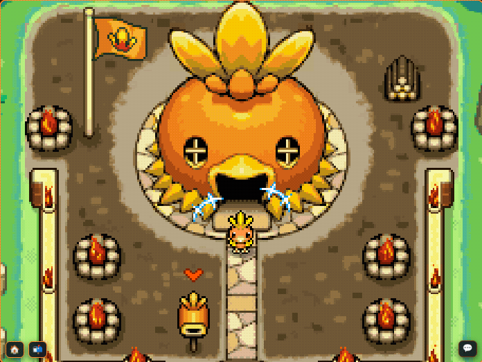

*The Rescue Team Base outside: a waving team flag, fire braziers, and the lead Pokémon in front of the hut. Sky flyers, Pelipper mail, and Ho-Oh feathers are separate scenes below.*

 

[🌐 **Launch Live Web App (GitHub Pages)**](https://helloyellow-hub.github.io/PMD-Rescue-Team-Wondermail-Generator/) · [📥 **Offline HTML (`PMD-Rescue-Team-Mail-Generator-v1.2.0.html`)**](PMD-Rescue-Team-Mail-Generator-v1.2.0.html) · [📖 **How to Use**](#-how-to-use-all-4-tabs) · [🆕 **What's new in 1.2.0**](#-whats-new-in-120) · [🏆 **Credits**](#-credits--acknowledgments)

---

## ✨ About This Project

If you still replay *Pokémon Mystery Dungeon: Red Rescue Team* or *Blue Rescue Team*, you probably know the pain of hunting down old Wonder Mail tools that have gone offline, or wiping on a deep floor of *Purity Forest* or *Wish Cave* with nobody around to rescue you.

This tool keeps Wonder Mail and rescue passwords in one place. It works offline, and it is built mobile-first. Open it in a phone or desktop browser, or download `PMD-Rescue-Team-Mail-Generator-v1.2.0.html`. That single file holds the sprites, portraits, maps, fonts, and password logic. `index.html` is the same file, so GitHub Pages serves this version.

You can roll a job, check an old code, or turn an SOS Mail password into an A-OK Mail and a Thank-You Mail. Around that, there is a Rescue Team Base, a Pelipper mailbox stored in your browser, a world map, and a 3-lane dungeon walker with Red/Blue floor information.

The password logic follows the original Red and Blue Rescue Team games. Shiny colors, Mega Rayquaza, and Primal Groudon and Kyogre are visual themes on top of that. They do not change what a cartridge accepts.

---

## 🚀 Quick Start

### 1. Play in Your Browser (GitHub Pages)
👉 **[https://helloyellow-hub.github.io/PMD-Rescue-Team-Wondermail-Generator/](https://helloyellow-hub.github.io/PMD-Rescue-Team-Wondermail-Generator/)**

GitHub Pages updates from the default branch. Until this version is merged, use the offline file below if you want `v1.2.0` specifically.

### 2. Use It Offline (Single HTML File)
1. Download [`PMD-Rescue-Team-Mail-Generator-v1.2.0.html`](PMD-Rescue-Team-Mail-Generator-v1.2.0.html) from this repository (it is the same bytes as [`index.html`](index.html)).
2. Open that file in Safari, Chrome, Firefox, or Edge. Cards, canvases, touch controls, and the password symbols (`♂`, `♀`, `…`) reflow on a phone. Browser zoom still leaves the text and buttons usable, and keyboard focus draws a high-contrast outline on the form controls.
3. No install, local server, or account is required. Wonder Mail pictures and the password tables are inside the file. A browser that blocks storage or the clipboard will say so in a status line instead of pretending the click worked.

The file ships with an empty mailbox (`SAVED_MAILS` starts as `[]`). Anything you save later stays in that browser's local storage. Export JSON if you want a backup you can move.

---

## 🆕 What's New in 1.2.0

These are visualization and reference features in the tool. The Wonder Mail and rescue-password bytes are still Red and Blue Rescue Team passwords.

### Emotion portraits and dialogue

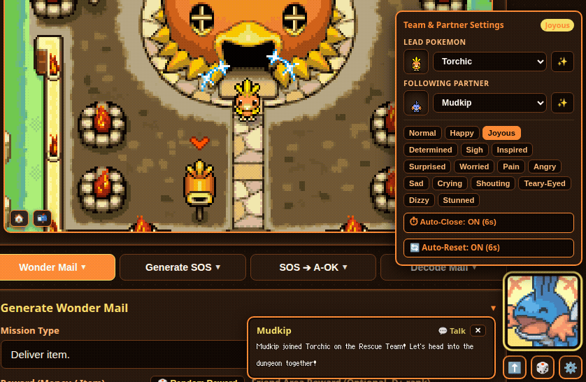

*The floating companion and the 16 emotion buttons. Torchic's portrait and the overhead emote follow the selected emotion. Spoken lines are the approved starter lines; emotions without a written line still change the portrait.*

- The expression picker lists all 16 standard PMDCollab emotions, for normal and shiny portraits: Normal, Happy, Joyous, Determined, Sigh, Inspired, Surprised, Worried, Pain, Angry, Sad, Crying, Shouting, Teary-Eyed, Dizzy, and Stunned.
- Lead and Partner keep separate portraits. The header portrait is the lead. The floating portrait is whoever is speaking.
- Starter lines follow that Pokémon's nature. Legendary leads use their own lore lines, including Mega Rayquaza and Primal Groudon and Kyogre when that form is on.
- Pain, Crying, Stunned, and Dizzy are available as portraits and overhead emotes. The written dialogue banks do not have a unique approved sentence for every one of those tags, so the face can change without inventing a new line.
- The original floating companion stays in the corner, with Talk, Randomize, and the settings gear. There is no separate dock.

### Shiny lead, shiny partner, and dynamic palettes

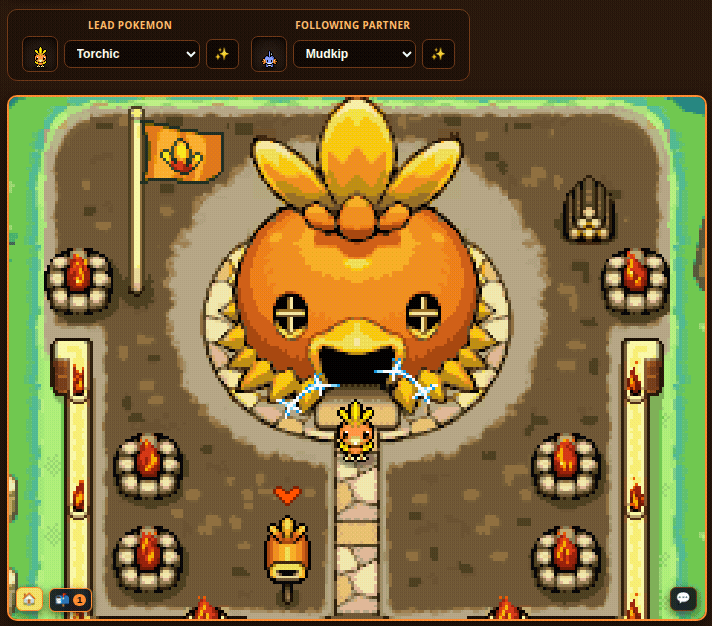

*✨ swaps the lead or the partner through a smoke puff. Mudkip's shiny palette recolors the page, the flag, and the sprite.*

- The ✨ buttons recolor the lead and the following partner. The swap plays the smoke puff, then the shiny sprites and portraits.
- The page palette follows the active lead, including the shiny lead colors.
- A shiny wild walk-by or a shiny sky flyer is a rare cosmetic roll in the scene (about 1 in 200 new passes, or a form that is already shiny, such as pink Celebi). That rate is only for this viewer. It does not edit the game's recruit rate or shininess.

### Mega Rayquaza, Primal Groudon, and Primal Kyogre

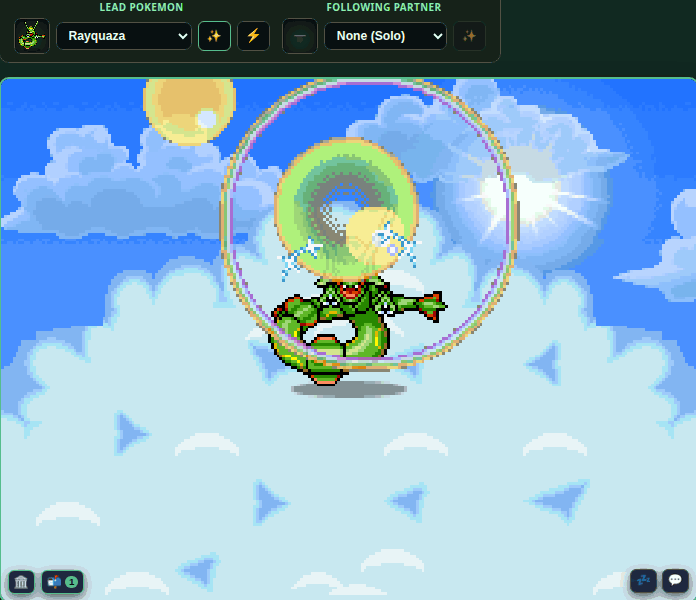

*Rayquaza's ⚡ Mega button, then Primal Groudon and Primal Kyogre, each with a normal and a shiny cosmetic.*

- On Rayquaza, Groudon, or Kyogre, ⚡ toggles Mega Rayquaza, Primal Groudon, or Primal Kyogre. Each has a normal and a shiny cosmetic palette, sprite, and portrait.
- These forms are not recruitable leads in Red and Blue Rescue Team. They are a visual costume on the Weather Trio friend areas. Turning one on does not change a password.
- Mega Rayquaza uses its Mega portrait while awake. Sleeping and the sigh face fall back to Rayquaza's closed eyes. Primal Groudon and Primal Kyogre keep the Primal portrait for those faces. A form without a real sleep sprite does not play the nap.

### Dungeon, Pokémon, and item viewers

These clips are pieces of one recorded walk, Squirtle with Meowth, played at 25 fps. Each piece repeats on its own, so the picture jumps when that piece starts again.

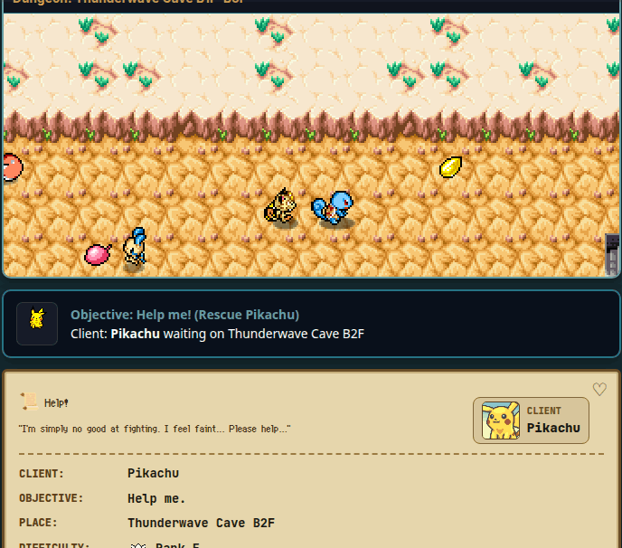

*Plusle on Thunderwave Cave: floors, level, and a recruitable rate.*

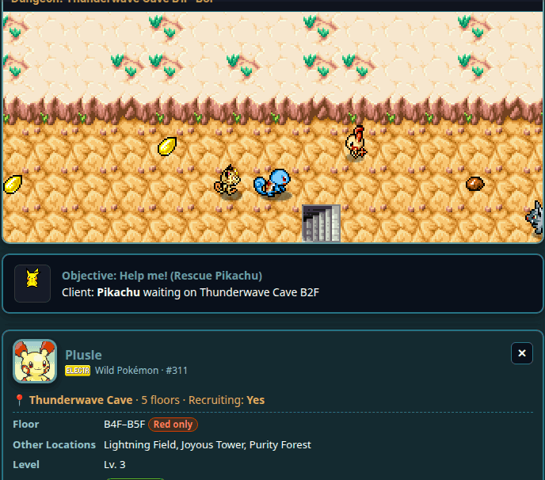

*Blast Seed, including that it spawns in this dungeon and the other places it is found.*

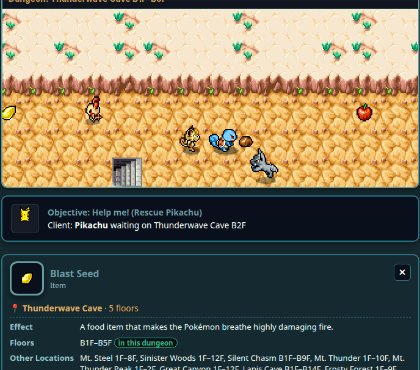

*Latias in Pitfall Valley, marked Story Join rather than a normal recruit battle.*

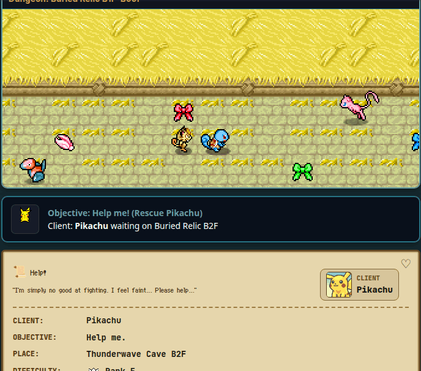

*Mew in Buried Relic, a Special Encounter with its floor and recruit rate.*

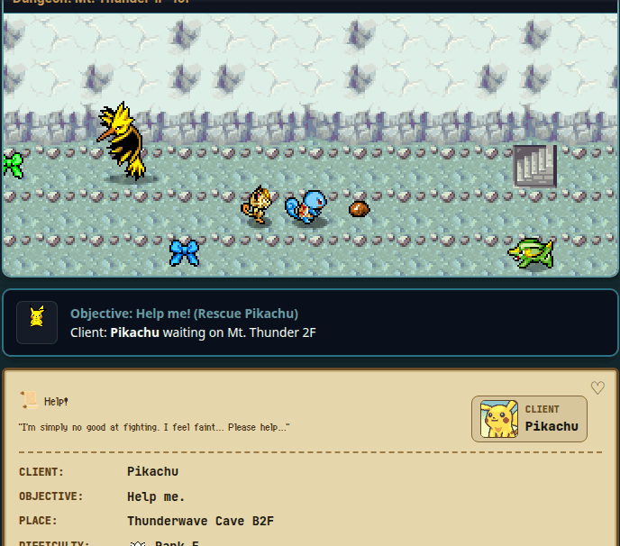

*Zapdos on Mt. Thunder as a Dungeon Boss, then Fire Stone with its evolution pairs and no price.*

- Click a wild Pokémon or a floor item in the 3-lane walker. The card keeps one main Pokémon portrait (or the item icon) and then text-only rows. Names can be clicked. Extra mini portraits are not repeated on each row.
- Recruit text matches the Red/Blue table: **Recruitable** with a percent when the game allows it, **Not recruitable**, or **Evolve only** with the pre-evolution and the item it needs. A negative rate notes Friend Bow and a high level.
- **Story Join Pokémon** are not labeled as dungeon bosses. Latias joins after the rescue in Pitfall Valley, with no battle. Celebi joins at Purity Forest 99F, with no battle.
- **Special Encounter** is separate. Mew appears with the Music Box in Buried Relic (B36F–B98F).
- **Dungeon Boss Pokémon** are the story and legendary fights that can walk through that dungeon, such as Zapdos on Mt. Thunder.
- Item cards list the short effect, floors in this dungeon, other Red/Blue locations, and evolution pairs such as Vulpix → Ninetales. There is no buy or sell price row.
- Floor lists, recruit rates, and item locations are the Red and Blue (Generation III) tables, stored in the file so the card works offline. This is not *Mystery Dungeon DX* data.

---

## 🌟 What's Inside

### 1. 📜 24-Character Wonder Mail Generator & Decoder
Create and inspect 24-character Pelipper Post Office Wonder Mail passwords (`XXXX XXXX XXXX` / `XXXX XXXX XXXX`) for *Red Rescue Team* and *Blue Rescue Team*:
- **All 5 Mission Types**:
  - `Help me` - Rescue the client on the target floor.
  - `Find someone` - Track down and rescue a target Pokémon for the client.
  - `Escort to X` - Escort the client through the dungeon to the target Pokémon.
  - `Find item` - Find a specific item inside the dungeon (or bring one in from your Toolbox).
  - `Deliver item` - Bring an item from your Toolbox and hand it to the client on the target floor.
- **Full Gen I-III Pokédex (`#001` Bulbasaur to `#386` Deoxys)**:
  - Search boxes filter Clients, Targets, Dungeons, and Rewards, with sprite previews. The generator blocks pairings the game rejects, such as the same Pokémon as both client and target on a rescue or escort.
- **Floors & Item Checks**:
  - Choosing a dungeon fills in its `B#F` or `#F` floor count and checks whether a requested item is a natural floor spawn there on *Find item* missions.
- **Rewards & Wonder Mail-Only Friend Areas**:
  - Pick `Money`, `Money + ? (Item)`, `Item`, `Item + ?`, or `Friend Area`. The four Wonder Mail-only Friend Areas are **Mt. Moonview**, **Sky Blue Plains**, **Dragon Cave**, and **Bountiful Sea**. A Friend Area reward is kept at least **D-Rank**, or **Pelipper Isle**.
- **Pelipper Post Office Letter Preview**:
  - A parchment job letter with the client portrait, headline and body, dungeon and floor, rank, difficulty, reward, and the 24-character code.
- **Wonder Mail Decoder**:
  - Paste a 24-character password. `♂` / `♀` / `…` work, and so do `(m)` / `(f)` / `...` or `M` / `F` / `.`. A bad checksum is reported as invalid. A good code fills the map, the walker, and the letter.

---

### 2. 🆘 54-Character SOS Mail, A-OK Mail & Thank-You Mail
Three-line, 54-character rescue passwords (`XXXXX XXXXXXXX XXXXX`):
- **SOS generator**:
  - Build an SOS Mail for a Pokémon, dungeon, floor, nickname (up to 10 characters), Mail ID (`0000`–`9999`), and rescue chances (`1`–`99`).
- **SOS ➔ A-OK and Thank-You**:
  - Paste that SOS Mail (or an existing A-OK Mail). **Generate A-OK & Thank-You Mail** writes a matching A-OK password and a Thank-You password. An optional reward item is attached to the Thank-You Mail.
  - The same rescue can be entered on a GBA, Nintendo DS, Virtual Console copy, or an emulator. This tool only makes the password. It does not connect to a game.
- **Checks**:
  - A short code, a bad checksum, or the wrong mail type is rejected in the error line. A valid code shows the mail type, dungeon, floor, Pokémon, nickname, mail ID, and chances.
- **Send onward**:
  - **➔ A-OK** on a generated SOS Mail opens the converter with that code filled in.

---

### 3. 🎨 19 Starter, Partner & Legendary Themes

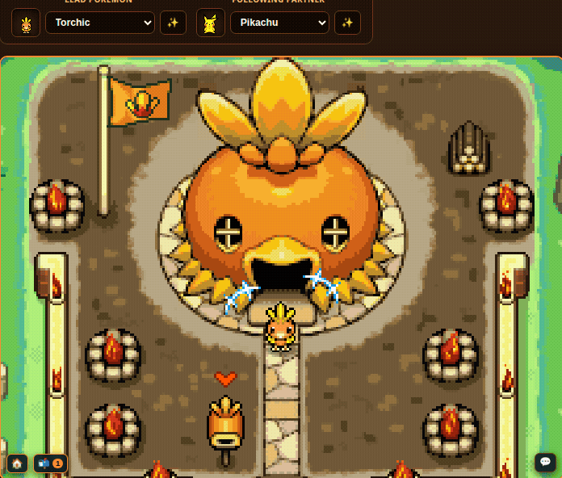

*A pass through the starter bases. Shiny colors and the Mega/Primal costumes are in the sections above; this strip is the base huts and flags.*

Pick a **Lead Pokémon** from 19 themes and a **Following Partner** (or `None`). Both dropdowns have an animated front-idle sprite. ✨ sits beside each one. ⚡ appears only for Rayquaza, Groudon, and Kyogre.

| Category | Themes Included | Visual Details |
| :--- | :--- | :--- |
| **Gen I-III Fire Starters (3)** | **Torchic** (`#255`), **Charmander** (`#004`), **Cyndaquil** (`#155`) | Fire hut, stone braziers outside and inside |
| **Gen I-III Water Starters (3)** | **Squirtle** (`#007`), **Totodile** (`#158`), **Mudkip** (`#258`) | Water hut and a matching team flag |
| **Gen I-III Grass Starters (3)** | **Bulbasaur** (`#001`), **Chikorita** (`#152`), **Treecko** (`#252`) | Leaf hut and a forest palette |
| **Personality-test starters (7)** | **Pikachu** (`#025`), **Meowth** (`#052`), **Psyduck** (`#054`), **Machop** (`#066`), **Cubone** (`#104`), **Eevee** (`#133`), **Skitty** (`#300`) | Each starter's hut, flag, and palette |
| **Classic Theme (1)** | **Classic / Riolu** (`#447`) | Classic blue theme with Riolu on a rock hut. Riolu is a costume here; Riolu is not a Red/Blue Rescue Team species. |
| **Weather Trio (3)** | **Rayquaza** (`#384`), **Groudon** (`#383`), **Kyogre** (`#382`) | The base is replaced by that legendary's friend area. ⚡ adds the cosmetic Mega or Primal form. |

---

### 4. 🏠 Rescue Team Base, Pelipper Mail, and Ho-Oh Feathers

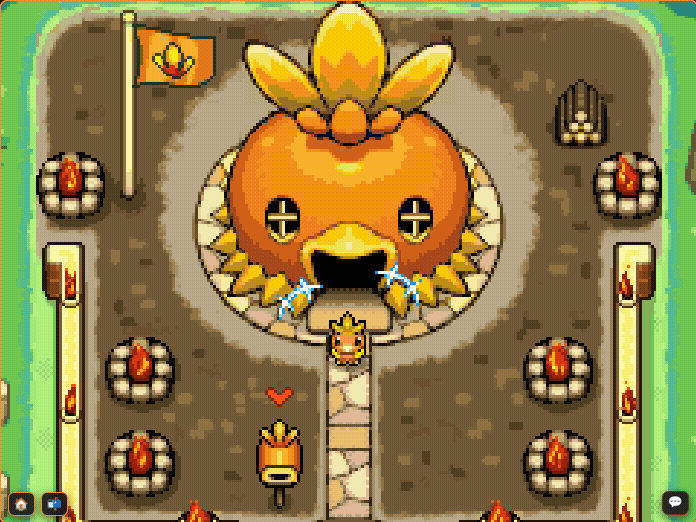

*Walk through the door, talk with your partner, nap on the cushion, and step back outside.*

 

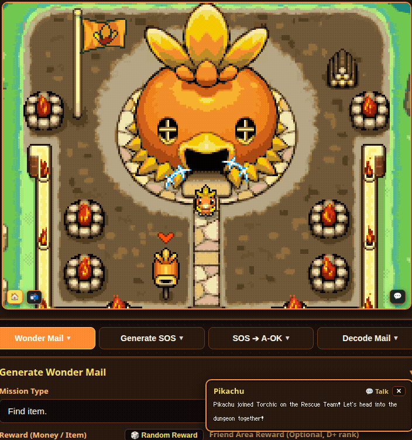

*Pelipper crosses the yard and drops a Wonder Mail letter. Open it, save it, and read it again from the Pelipper mailbox.*

 

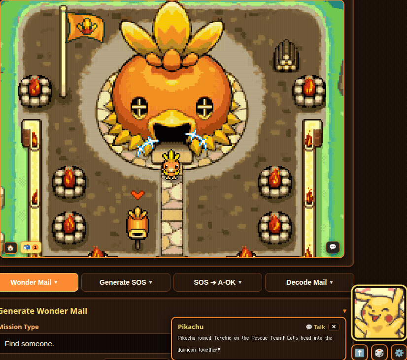

*Ho-Oh flies over the base and lets a feather drift down. Picking it up is its own moment, separate from Pelipper's letter.*

- **Outside**:
  - The team flag waves beside the hut. Torchic, Charmander, and Cyndaquil light the stone braziers.
  - **📬 Pelipper Mailbox**: the post by the base, or ♡ on a password, saves Wonder Mail, SOS Mail, A-OK Mail, and Thank-You Mail in this browser. Filter, search, load a code back into the tool, export JSON, or import a backup. If storage cannot be written, the previous mailbox is kept and a status line says the save failed.
  - **Pelipper mail**: Pelipper flies past and drops a Wonder Mail letter on the yard. The letter opens a Pelipper Delivery card. That card is only the mail drop.
  - **Other sky flyers and Ho-Oh feathers**: Wingull, Murkrow, Swablu, Altaria, Fearow, and rarer legendary flybys cross the sky. Ho-Oh can release a Clear, Red, Sunset, or Rainbow Wing. The feather sways down on its own and is not a mail letter. A very rare shiny Celebi can pass as a sky flyer.
  - **💬** on the lead, outdoors, is the lead's own thought, with a PMD1 emote over their head.
- **Inside** (`🏠` / the doorway):
  - The lead walks in to the partner.
  - **💤** curls up on the cushion with floating Zs.
  - **💬** walks the lead over to the partner for a face-to-face line. Clicking the lead still uses the lead's own thought.
  - **👣** returns to the middle of the room. The red south arrow, or 🌲, walks back outside.
- **Copying a password**: the status line says it is copying, then either "Password copied to clipboard." or that the copy failed and the code should be selected by hand. A click alone is not treated as success.

---

### 5. 🌋 Weather Trio Friend Areas

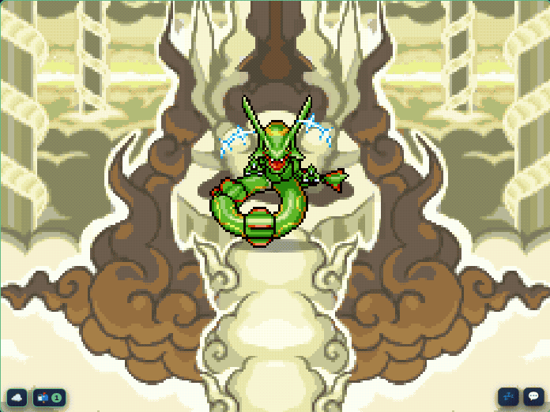

*Rayquaza switches between Stratos Lookout and Sky Tower Summit. Groudon rests in the Volcanic Pit. Kyogre rests in Seafloor Cave.*

Choosing a Weather Trio lead replaces the hut with that friend area. Sleep and talk still work when the sprite has them.
- **Rayquaza**: Stratos Lookout and Sky Tower Summit. The ☁️ / 🏛️ button swaps the two. Mega Rayquaza is the ⚡ costume on this area, not a third dungeon.
- **Groudon**: Volcanic Pit, with the magma falls. ⚡ is Primal Groudon.
- **Kyogre**: Seafloor Cave, with the rising bubbles. ⚡ is Primal Kyogre.

---

### 6. 🗺️ PMD1 World Map

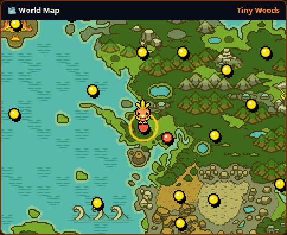

*The Red and Blue overworld eases toward the dungeon you pick and keeps a marker on it.*

The map above the job letter follows the selected dungeon, including when a password is decoded. It is the Red and Blue Rescue Team overworld, not the DX map.

---

### 7. ⚔️ 3-Lane Dungeon Walker

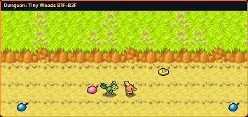

*The loop opens and closes on Torchic with Treecko in Tiny Woods. Both wild lanes are off the picture at that join, so the floor, the team, and the items line up when it restarts. The follower changes to Eevee and the lead to Squirtle. They walk Thunderwave Cave, Mt. Blaze, Magma Cavern, Mt. Freeze, and Mt. Thunder, then Stormy Sea, where Bulbasaur walks in once and they escort it toward Charmander before it walks off. Sky Tower comes next, and the team returns to Torchic and Treecko in Tiny Woods.*

- **Tiles**: the floor and walls follow that dungeon's Red/Blue tileset.
- **Your team**: lead, following partner, and, on an escort, the client, walk the middle lane. Shiny and Mega/Primal costumes show here too, with the same smoke puff as the base.
- **Wild Pokémon**: each dungeon draws from the Red/Blue species that appear anywhere in that dungeon, not from a generic national-dex shuffle. Bosses and legendaries stay on their own rare walk-by roll. Kecleon still uses the shop-dungeon rules (a green Kecleon is uncommon, a purple Kecleon is rarer).
- **Boss walk-bys**: at most one boss sprite per walk, and never two at once. Rayquaza, Groudon, or Kyogre will not spawn as the boss of their own dungeon while they are your lead. Story joins such as Latias are not pulled from the boss list.
- **Footer**: client and target, place, objective, reward, and difficulty. On a find-item or deliver-item job, the item name opens the item card, including whether that item is a floor spawn in this dungeon.

---

### 8. 💬 Floating Partner
- Click the partner portrait or **💬 Talk** for a line as you roll missions, decode a code, or change dungeon and items.
- **⚙️** opens the team selectors, the shiny buttons, the ⚡ form button when it applies, and the 16 emotion buttons. Auto-close is a 6 second timer you can turn off.
- **🎲** rolls a game-valid Wonder Mail and refreshes the map, walker, and letter.
- The companion stays a floating hover in the corner. Reduced-motion settings do not turn that companion off. See the note below.

---

## 📖 How to Use (All 4 Tabs)

### Tab 1: `Wonder Mail` (24-Character Passwords)
1. Pick a mission type, or press **🎲**.
2. Choose the client and, when the mission needs one, the target. Search boxes filter all 386 Gen I–III Pokémon.
3. Choose the dungeon and floor. A Friend Area reward is forced to at least Rank D, or Pelipper Isle.
4. Pick the reward: money, an item, or a Friend Area.
5. Press **Generate Wonder Mail**. Enter the two-line code in *Red* or *Blue Rescue Team* under **Main Menu ➔ Wonder Mail ➔ Receive Wonder Mail ➔ Password**.

### Tab 2: `Decode Mail` (24-Character Inspector)
1. Paste a 24-character Wonder Mail. The symbol buttons insert `♂`, `♀`, and `…`.
2. Press **Decode Wonder Mail**. A valid code shows the mission, client, target, dungeon, floor, rank, reward, and letter on the map and the parchment. An invalid code stays invalid.

### Tab 3: `SOS ➔ A-OK` (54-Character Rescue)
1. After fainting, copy the 54-character SOS Mail from the Pelipper Post Office menu.
2. Paste it into this tab.
3. Optionally choose a bonus reward item for the Thank-You Mail.
4. Press **Generate A-OK & Thank-You Mail**. Enter the A-OK password under **Receive A-OK Mail** to revive on the floor where you fainted. The Thank-You password is the rescuer's reward code.

### Tab 4: `Generate SOS` (54-Character SOS Mail)
1. Choose the fainted Pokémon, nickname, dungeon, floor, rescue chances, and optional mail ID.
2. Press **Generate SOS Mail** for the 3-line code, or press **➔ A-OK** to drop that code into the converter.

♡ on any of these results saves it in the Pelipper mailbox.

---

## ⚠️ In-Game Rules to Keep in Mind (*Red & Blue Rescue Team*)

The game still checks your save before it accepts a password. This page does not read your cartridge.
1. **The dungeon has to be unlocked** on that save.
2. **Friend Areas**:
   - An escort, or a client who wants to join, needs the Friend Area already.
   - For the four Wonder Mail-only Friend Areas, you must not already own that area, and the job has to be at least Rank D or set at Pelipper Isle. The generator enforces the rank rule.
3. **Password symbols**: `♂` is the male sign, `♀` is the female sign, and `…` is the single ellipsis key, not three periods.

---

## 🧭 What This Version Does Not Claim

- **Red and Blue Rescue Team only.** Dungeon floors, spawns, items, recruit rates, and boss lists are the original games' Generation III data. They are not *Mystery Dungeon DX*, and they are not Explorers of Sky jobs.
- **Shiny colors, the 1-in-200 viewer roll, Mega Rayquaza, and the Primal forms are cosmetic.** They change pixels in this page. They do not change checksums, recruit rates, or what the cartridge will accept.
- **Nothing here was checked by typing the codes into a game during this update.** The password checks are the published Red/Blue checksum and field tests. A code can still be rejected in-game if the save has not unlocked that dungeon or Friend Area.
- **Reduced motion is partial.** When the system asks for less motion, CSS animations and transitions outside the floating companion are turned off. The companion, the base scene, and the dungeon walker keep their canvas animation. This is not a full reduced-motion pass.
- **The mailbox in the download is empty.** Saves live in the browser. Export JSON to keep them. A storage failure restores the previous list and says so.

---

## 🏆 Credits & Acknowledgments

### 🛠️ Project Creator
- **Put Together by:** **Dave Alfred** [[GitHub]](https://github.com/helloyellow-hub)

### 🔐 Password & Checksum Research
- **[UPokeCenter (Peter O. / The Ultimate Pokémon Center)](https://www.upokecenter.com/games/dungeon/guides/wondermail.php)** for the original Red and Blue Rescue Team 24-character Wonder Mail and 54-character SOS / A-OK / Thank-You Mail bit layout, checksums, encryption tables, mission rules, and flavor text (`wondermail.php` and `sosgen.php`).

### 🎨 Sprites, Portraits & Maps
- **[The Spriters Resource](https://www.spriters-resource.com/game_boy_advance/pokemonmysterydungeonredrescueteam/)** for Rescue Team Base huts, flags, braziers, friend-area backgrounds, Pelipper, and PMD1 emotion icons (ripped by KillerAslox).
- **[PMD Collab / SpriteCollab](https://sprites.pmdcollab.org/)** for portraits and walking sprites, including the 16-emotion set and the shiny and Mega/Primal costume art used as cosmetics.
- **[Bulbapedia](https://bulbapedia.bulbagarden.net/wiki/Pok%C3%A9mon_Mystery_Dungeon:_Red_Rescue_Team_and_Blue_Rescue_Team)** for the Red/Blue dungeon, item, rank, boss, and overworld references embedded in the walker cards. Those cards use the Generation III sections of the dungeon pages.

### 🎮 Original Games
- ***Pokémon Mystery Dungeon: Red Rescue Team* & *Blue Rescue Team*** by **Chunsoft (Spike Chunsoft)**, published by **Nintendo** and **The Pokémon Company** (© 2005–2006 Nintendo / Creatures Inc. / GAME FREAK inc. / Chunsoft).
- This is an unofficial, non-commercial fan project. Pokémon names, characters, sprites, and trademarks belong to their owners.
