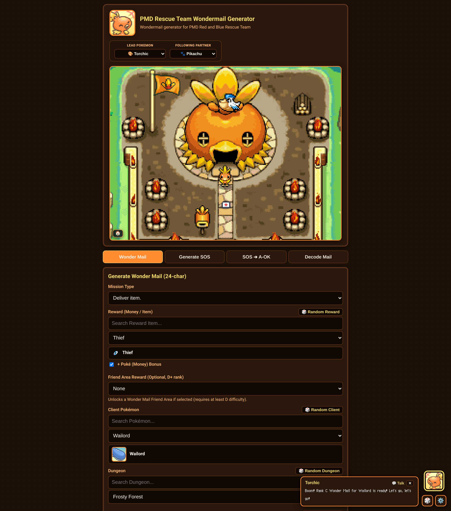
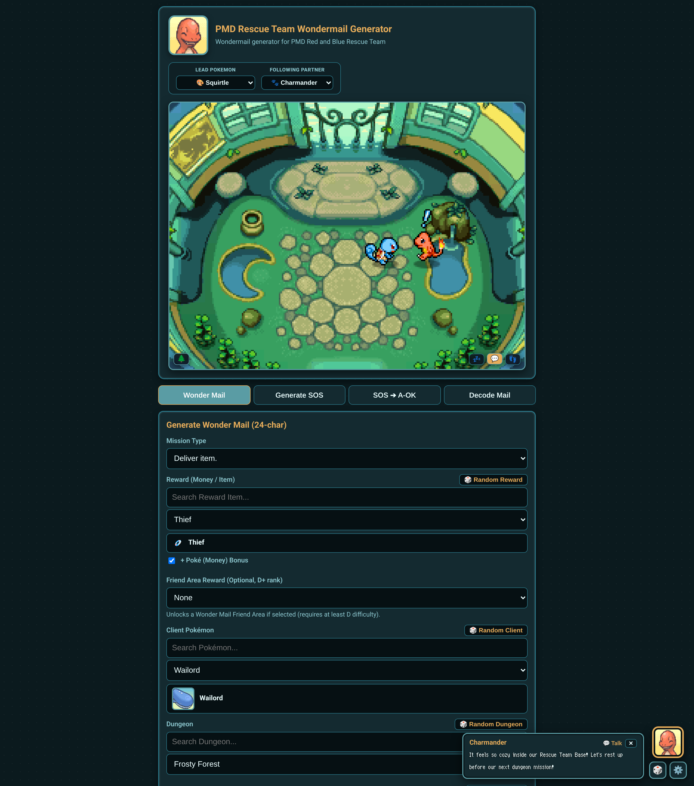
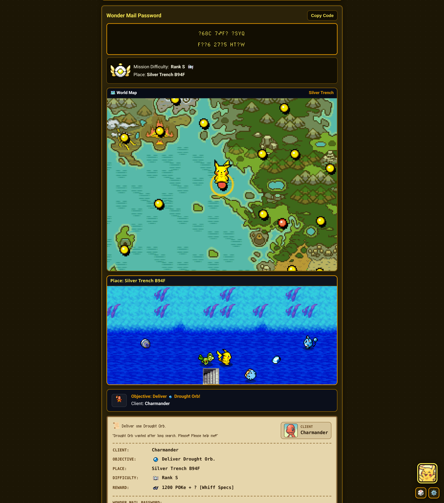
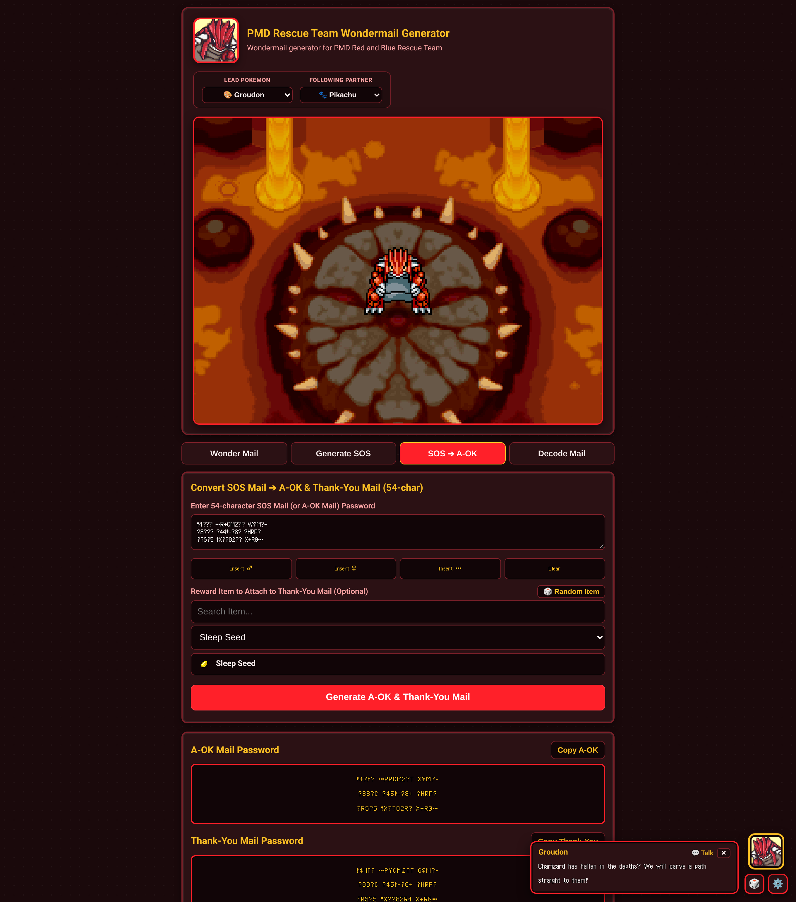
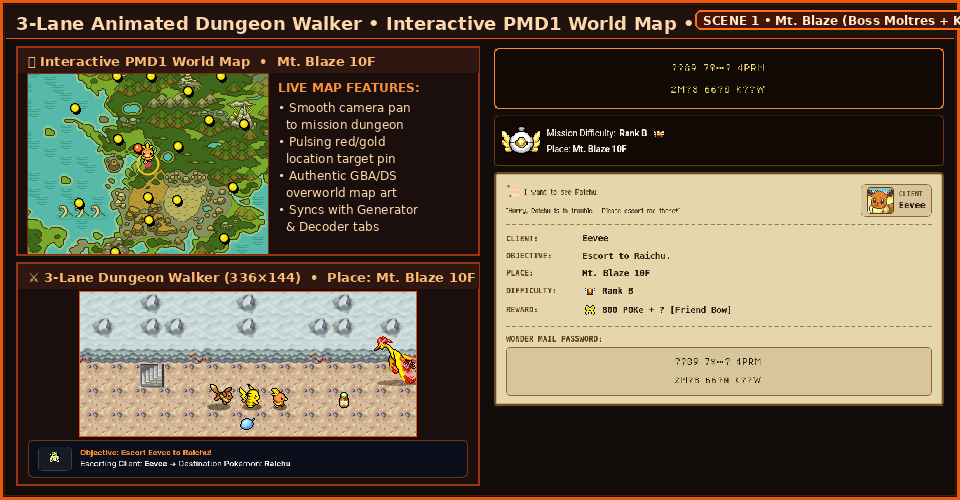

# 📮 PMD Rescue Team Wonder Mail & SOS Mail Generator (`v1.0`)

**Standalone, 100% Offline Password Suite & Interactive Pixel-Art Diorama for _Pokémon Mystery Dungeon: Red Rescue Team_ (GBA) & _Blue Rescue Team_ (Nintendo DS)**

 

*Above: The **Interactive Rescue Team Base Diorama** in **Outdoor Mode** (6-frame waving team flag, 10 animated fire braziers, Pelipper sky mail drop, and clickable Wonder Mail letter with a 7-frame purple smoke poof) and **Indoor Mode** (talking to your Partner with PMD1 emotes, sleeping on the cushion bed with rising `Zzz`s, and standing on the center emblem).*

 

[🌐 **Launch Live Web App (GitHub Pages)**](https://helloyellow-hub.github.io/PMD-Rescue-Team-Wondermail-Generator/) · [📦 **GitHub Releases (`v1.0.0`)**](https://github.com/helloyellow-hub/PMD-Rescue-Team-Wondermail-Generator/releases/latest) · [📥 **Direct Offline HTML (`PMD-Rescue-Team-Mail-Generator-v1.0.html`)**](PMD-Rescue-Team-Mail-Generator-v1.0.html) · [📖 **How to Use**](#-how-to-use-all-4-tabs) · [🏆 **Credits**](#-credits--acknowledgments)

---

## ✨ Overview

**PMD Rescue Team Wonder Mail & SOS Mail Generator (`v1.0`)** is a standalone, zero-dependency, 100% offline-capable single-file HTML application (`PMD-Rescue-Team-Mail-Generator-v1.0.html`) for generating, decoding, and converting **Wonder Mail** (24-character), **SOS Mail**, **A-OK Mail**, and **Thank-You Mail** (54-character) passwords for ***Pokémon Mystery Dungeon: Red Rescue Team* (GBA)** and ***Blue Rescue Team* (Nintendo DS)**.

Every bit-packing encryption table, checksum validator, dungeon floor rule, CHUNSOFT character portrait, GBA/DS overworld sprite, Rescue Team Base hut, Legendary Friend Area lair, and dungeon background is embedded directly inside **`PMD-Rescue-Team-Mail-Generator-v1.0.html`**. Whether you want to generate a specific **Friend Bow** or **Golden Seed** mission, unlock Wonder Mail-exclusive **Friend Areas**, decode an old password, or rescue yourself from a fainted floor in *Purity Forest* or *Wish Cave* by converting an **SOS Mail ➔ A-OK Mail**, everything runs instantaneously in any desktop or mobile browser—online or completely offline.

---

## 📸 Full-Interface Preview Gallery

| 🏕️ Outdoor Rescue Team Base & Wonder Mail Generator | 🏠 Indoor Rescue Team Base Diorama & Partner Talk (`💬`) |
| :---: | :---: |
|  |  |
| *Starter-specific Outdoor Rescue Team Base hut, waving team flag, fire braziers, clickable Pelipper mail delivery, and 24-character Wonder Mail Generator controls.* | *Interactive Indoor Rescue Team Base (`🏠`) featuring Sleep (`💤`), Talk to Partner (`💬`) with authentic PMD1 emotion icons & dialogue bubbles, and Stand (`👣`).* |
| **🗺️ Live World Map, 3-Lane Dungeon Walker & Client Letter** | **🌋 Legendary Friend Area Theme & SOS ➔ A-OK Converter** |
|  |  |
| *Generated Wonder Mail password with Rank badge, animated World Map dungeon flight tracker, 3-lane dungeon walker, and authentic parchment client letter.* | *Weather Trio Legendary Friend Area diorama (*Volcanic Pit* with Groudon, *Stratos Lookout*, *Seafloor Cave*) alongside the 54-character SOS ➔ A-OK & Thank-You Mail Converter.* |

---

## 🚀 Live Demo & Quick Start

### 1. Play Instantly in Your Browser (GitHub Pages)
👉 **[https://helloyellow-hub.github.io/PMD-Rescue-Team-Wondermail-Generator/](https://helloyellow-hub.github.io/PMD-Rescue-Team-Wondermail-Generator/)**

### 2. Run 100% Offline (Single-File Standalone HTML)
1. Download **[`PMD-Rescue-Team-Mail-Generator-v1.0.html`](PMD-Rescue-Team-Mail-Generator-v1.0.html)** (or grab it from **[GitHub Releases](https://github.com/helloyellow-hub/PMD-Rescue-Team-Wondermail-Generator/releases/latest)**).
2. Open **`PMD-Rescue-Team-Mail-Generator-v1.0.html`** directly in any modern desktop or mobile browser (`Chrome`, `Firefox`, `Safari`, `Edge`).
3. **No internet connection, no local server, and no installation required.** All 386 Pokémon sprites, portraits, maps, fonts, and password engines run locally inside the single file.

---

## 🌟 Complete Feature & Function Breakdown

### 1. 📜 24-Character Wonder Mail Generator & Decoder
Generate and inspect authentic **24-character Pelipper Post Office Wonder Mail passwords** (`XXXX XXXX XXXX` / `XXXX XXXX XXXX`) compatible with both *Red Rescue Team* (GBA) and *Blue Rescue Team* (NDS):
- **All 5 Official Mission Types**:
  - `Help me` — Rescue the client Pokémon on the target floor.
  - `Find someone` — Locate and rescue the target Pokémon for the client.
  - `Escort to X` — Escort the client Pokémon through the dungeon to the target Pokémon.
  - `Find item` — Obtain a specific requested item inside the selected dungeon (or bring one from your Toolbox).
  - `Deliver item` — Bring an item into the dungeon and deliver it to the client on the target floor.
- **Complete Gen I–III Pokédex (`#001` Bulbasaur – `#386` Deoxys)**:
  - Filter Clients, Targets, Dungeons, and Rewards instantly with live search boxes and animated sprite previews across all 386 species, with automatic validation against game-locked pairs (e.g., Client and Target cannot be identical on rescue/escort jobs, and boss-only legendaries are guarded appropriately).
- **Accurate Dungeons, Floors & Smart Item Verification (`ItemInDungeon`)**:
  - Automatically populates exact `B#F` / `#F` floor ranges for every dungeon in the game and verifies whether a chosen item naturally spawns in the selected dungeon on *Find item* missions.
- **All Reward Types & Friend Area Unlocks**:
  - Supports `Money`, `Money + ? (Item)`, `Item`, `Item + ?`, and `Friend Area` rewards (supporting the 4 Wonder Mail-exclusive Friend Areas: **Mt. Moonview**, **Sky Blue Plains**, **Dragon Cave**, and **Bountiful Sea**, and automatically enforcing the in-game requirement of at least **D-Rank** mission difficulty or **Pelipper Isle**).
- **Authentic Parchment Client Letter Preview**:
  - Live-rendered Pelipper Post Office job letter displaying the client's left-facing CHUNSOFT portrait, authentic PMD1 headline & flavor dialogue, dungeon/floor, **GBA Rescue Team Rank badge**, difficulty points, reward item icon, and copyable **24-character Unicode password** (`♂`, `♀`, `…`).
- **24-Character Wonder Mail Decoder**:
  - Paste any 24-character Wonder Mail code (accepts both Unicode `♂` / `♀` / `…` and ASCII shorthand `(m)` / `(f)` / `...` or `M` / `F` / `.`) to verify its bit-packed checksum, inspect every parameter, and preview the decoded mission live on the World Map, 3-Lane Dungeon Walker, and Parchment Letter.

---

### 2. 🆘 54-Character SOS Mail, A-OK Mail & Thank-You Mail Suite
Full support for **54-character Rescue Passwords** (`XXXXX XXXXXXXX XXXXX` across 3 rows):
- **Bi-Directional SOS ➔ A-OK Mail Converter**:
  - Fainted in *Silver Trench*, *Buried Relic*, *Wish Cave*, or *Purity Forest*? Paste your 3-line (54-character) **SOS Mail** password to immediately generate a matching **54-character A-OK Mail** rescue password—and optionally attach a **Bonus Reward Item** to generate a **Thank-You Mail** password.
  - Rescue yourself or friends across GBA, Nintendo DS, Virtual Console, and emulators **without needing a GBA Link Cable or DS Wireless connection**.
- **SOS / A-OK / Thank-You Mail Decoder**:
  - Inspect any 54-character password to view its Mail Type, Faint Dungeon & Floor, Fainted Pokémon species & nickname, 4-digit Mail ID, Rescue Chances remaining, and Rescuer name.
- **Custom 54-Character SOS / A-OK / Thank-You Mail Generator**:
  - Generate custom 54-character **SOS Mail**, **A-OK Mail**, or **Thank-You Mail** codes from scratch for any Pokémon, dungeon, floor, nickname, **4-Digit Mail ID** (`0000`–`9999`), **Remaining Rescue Chances** (`1`–`99`), and **Reward Item**, with one-click transfer into the SOS ➔ A-OK Converter.

---

### 3. 🎨 19 Interactive Lead Pokémon, Partner & Legendary Themes

*Above: Cycling through the **19 dynamic themes** — transforming the UI color palette, CHUNSOFT starter portrait, Rescue Team Base hut or Legendary Friend Area lair, and Floating Partner Companion.*

Choose from **19 handcrafted themes** via the **Lead Pokémon** selector, and pair your Lead with any of the **17 Following Partners** (or `None` for solo runs):

| Category | Themes Included | Special Visual Details |
| :--- | :--- | :--- |
| **Gen I–III Fire Starters (3)** | **Torchic** (`#255`), **Charmander** (`#004`), **Cyndaquil** (`#155`) | Species-specific Fire Hut + **10 outdoor & 5 indoor animated flaming stone braziers** |
| **Gen I–III Water Starters (3)** | **Squirtle** (`#007`), **Totodile** (`#158`), **Mudkip** (`#258`) | Species-specific Water Base Hut + ocean/aqua UI palette & matching team flag |
| **Gen I–III Grass Starters (3)** | **Bulbasaur** (`#001`), **Chikorita** (`#152`), **Treecko** (`#252`) | Species-specific Forest Leaf Base Hut + botanical emerald/sage UI palette |
| **PMD1 Personality Test Starters (7)** | **Pikachu** (`#025`), **Meowth** (`#052`), **Psyduck** (`#054`), **Machop** (`#066`), **Cubone** (`#104`), **Eevee** (`#133`), **Skitty** (`#300`) | Authentic species-shaped Rescue Team Bases + custom team flags & partner palettes |
| **Classic Theme (1)** | **Classic / Riolu** (`#447`) | Clean dark-slate aesthetic featuring the **classic Rock Hut Rescue Team Base** |
| **Weather Trio Legendaries (3)** | **Rayquaza** (`#384`), **Groudon** (`#383`), **Kyogre** (`#382`) | Replaces the Rescue Team Base with each Legendary's animated **Friend Area Lair** |

---

### 4. 🏠 Interactive Rescue Team Base Diorama (Outdoor & Indoor Modes)
At the top of the app sits a living **`240×180` native GBA/DS pixel-art diorama** of your Rescue Team Base:
- **Outdoor Mode**:
  - **6-Frame Waving Team Flags**: Your starter's custom emblem flag waves smoothly in the breeze beside the base.
  - **Outdoor & Indoor Flaming Braziers**: Selecting **Torchic**, **Charmander**, or **Cyndaquil** lights up 10 stone fire braziers around the outdoor courtyard and 5 indoor wall braziers with multi-frame flickering flames.
  - **Ambient Sky Flyers & Legendary Easter Eggs**: Periodic solo flying Pokémon (*Pelipper, Wingull, Murkrow, Swablu, Altaria, Fearow*) plus rare 1% Easter egg flybys (*Latias, Latios, Articuno, Zapdos, Moltres, Lugia, Ho-Oh, Mew, Celebi,* and *Jirachi*, plus ultra-rare *Shiny Celebi*) across randomized flight bands above the hut entrance.
  - **Clickable Pelipper Sky Mail Drop**: Periodically, **Pelipper** flies across the sky and drops a fluttering **Wonder Mail Letter** right in front of your Lead Pokémon at `(120, 142)`, triggering an authentic PMD1 **`!`** reaction. **Click or tap the dropped letter** to trigger a **7-frame purple smoke poof**, roll a brand-new Wonder Mail mission, and smoothly scroll down to the generated client letter!
- **Indoor Mode (`🏠` / `🌲` Toggle)**:
  - Click the **`🏠`** button in the bottom-left corner of the diorama to step inside your starter's authentic Rescue Team Base interior room alongside your **Following Partner**:
    - **`💤` (Sleep on the Bed)**: Your Lead Pokémon teleports onto the room's cushion bed in a 7-frame purple smoke poof and curls up in its authentic sleeping sprite with rising **`Zzz`** icons. Clicking `💤` or `🌲` while sleeping wakes your Pokémon back to the center floor first with a confused `?` reaction.
    - **`💬` (Talk to Partner)**: Your Lead Pokémon steps beside your Following Partner (`(146, 110)` next to `(174, 110)`), both turn to face each other (East/West directional sprites), display an authentic PMD1 emotion icon (`!`, `?`, sweat drop, shock spikes, or happy sparkles), and trigger a personality-matched Partner dialogue bubble before turning back toward the front.
    - **`👣` (Stand in the Room)**: Returns your Lead Pokémon to the center floor emblem (`(120, 118)`) with a purple smoke poof.

---

### 5. 🌋 Animated Legendary Friend Areas (Weather Trio Showcase)

*Above: The three **Weather Trio Legendary Themes** — **Rayquaza** at *Stratos Lookout*, **Groudon** at *Volcanic Pit* (pulsing magma runes, dual lava waterfalls & popping lava bubbles), and **Kyogre** at *Seafloor Cave* (pulsing abyssal floor sigil & rising deep-sea bubbles).*

Selecting one of the **Weather Trio Legendaries** transforms the top diorama into their iconic *Red/Blue Rescue Team* **Friend Area**:
- **Rayquaza (`#384`) — *Stratos Lookout***: Rayquaza rests atop the ancient Sky Shrine altar high above the clouds with drifting cloud layers and an emerald-and-gold sky aura theme.
- **Groudon (`#383`) — *Volcanic Pit***: Features an **8-frame pulsing magma altar glow** around Groudon, **dual cascading lava waterfalls** with splash pools pouring down the upper cliffs, and **3-frame bubbling lava pools** that rise and pop across the liquid magma.
- **Kyogre (`#382`) — *Seafloor Cave***: Features a **pulsing crimson-gold ancient floor sigil** beneath Kyogre and continuous **rising underwater bubble streams** drifting up through the deep-sea cavern.

---

### 6. 🗺️ Interactive PMD1 World Map & 3-Lane Animated Dungeon Walker

*Above: Live **Interactive PMD1 World Map** camera pan & pulsing target pin paired with the **3-Lane Animated Dungeon Walker (`336×144`)**, **Unicode `♂`/`♀`/`…` Password Box**, **GBA Rank Bar**, and **Authentic Parchment Mission Letter**.*

Every generated or decoded Wonder Mail mission comes alive through two synchronized canvas engines located directly above the Parchment Client Letter:
- **Interactive PMD1 World Map (`240×180`)**:
  - Smoothly pans across the authentic *Red/Blue Rescue Team* overworld map and flies an animated marker + glowing target reticle to the selected dungeon's exact coordinates whenever you change dungeons or decode a password.
- **3-Lane Animated Dungeon Walker (`336×144`)**:
  - Renders the authentic **dungeon floor & wall tileset** matching the selected dungeon's biome (volcanic rock in *Mt. Blaze*, crystal crater tiles in *Meteor Cave*, forest paths in *Tiny Woods*, etc.), complete with dungeon stairs and scattered floor items.
  - **Middle Lane (Rescue Team Party)**: Your **Lead Pokémon**, **Following Partner**, and (on *Escort* missions) the **Escort Client** materialize via a purple smoke poof and march East together in formation.
  - **Top & Bottom Depth Lanes (Wild Spawns, 25 Dungeon Bosses & Kecleon)**:
    - Spawns authentic **wild Pokémon** native to that specific dungeon walking West across the upper and lower depth lanes.
    - **All 25 PMD1 Dungeon Bosses**: Selecting a Boss Dungeon spawns its iconic boss patrolling the outer lanes—including **Moltres**, **Zapdos**, **Articuno**, **Groudon**, **Rayquaza**, **Kyogre**, **Mewtwo**, **Lugia**, **Ho-Oh**, **Celebi**, **Jirachi**, **Regirock**, **Regice**, **Registeel**, **Entei**, **Raikou**, **Suicune**, **Latios**, and all **4 Deoxys Formes** (*Normal*, *Attack*, *Defense*, and *Speed*) in **Meteor Cave**.
    - **Rare Green & Purple Kecleon Walk-Bys**: In dungeons that can spawn Kecleon Shops, **Green Kecleon** and **Purple Kecleon** (`0.5%` rate) occasionally stroll across the outer lanes.
  - **Mission Summary Footer**: Displays animated front-facing client & target sprites alongside a live objective readout (`Place`, `Objective`, `Client`, `Reward`, and `Difficulty`).

---

### 7. 💬 Floating Partner Companion & Quick Randomizer (`🎲`)
- **Interactive Partner Bubble**: Tap your Partner's portrait (or the `💬 Talk` pill) in the bottom-right corner for personality-matched commentary when generating codes, decoding passwords, changing dungeons/items, or idling.
- **Expression & Dialogue Settings (`⚙️`)**: Switch between *Neutral, Happy, Inspired, Determined,* and *Worried* CHUNSOFT portraits, and toggle `⏱ Auto-Close (6s)` or `🔄 Auto-Neutral (4.5s)`.
- **One-Tap Mission Randomizer (`🎲`)**: Click the **`🎲`** button in the Floating Partner dock (or next to *Generate Wonder Mail*) to roll a 100% valid, conflict-free Wonder Mail mission and update the World Map, 3-lane dungeon scene, and parchment client letter in one click.

---

## 📖 How to Use (All 4 Tabs)

### Tab 1: `Wonder Mail Generator` (24-Character Passwords)
1. **Pick a Mission Type** (`Help me`, `Find someone`, `Escort to X`, `Find item`, or `Deliver item`)—or click **`🎲`** to roll a complete valid mission automatically.
2. **Select Client & Target Pokémon**:
   - Search and pick from all **386 Gen I–III Pokémon** using the live filter boxes above each dropdown.
3. **Select Dungeon, Floor & Flavor Text**:
   - Choose the **Dungeon** and **Floor** (for *Friend Area* rewards, the generator automatically ensures the mission is at least **Rank D** difficulty or at *Pelipper Isle*).
   - Optionally customize the **Headline** and **Letter Body** text or keep the authentic defaults.
4. **Choose Your Reward**:
   - Select `Money`, `Money + ? (Item)`, `Item`, `Item + ?`, or `Friend Area`, then pick any item (`Friend Bow`, `Golden Seed`, `Tight Belt`, `Gold Ribbon`, `TM`s, etc.) or Wonder Mail-exclusive Friend Area.
5. **Click `Generate Wonder Mail`**:
   - Enter the resulting **2-line 24-character password** (`XXXX XXXX XXXX` / `XXXX XXXX XXXX`) in *Pokémon Mystery Dungeon: Red/Blue Rescue Team* via **Main Menu ➔ Wonder Mail ➔ Receive Wonder Mail ➔ Password**.

### Tab 2: `Wonder Mail Decoder` (24-Character Inspector)
1. Paste any **24-character Wonder Mail password** into the decoder box (use the **`♂`**, **`♀`**, and **`…`** quick-insert buttons, or type `(m)`, `(f)`, `...`).
2. Click **`Decode Wonder Mail`** to validate its bit-packed checksum and inspect the exact **Mission Type**, **Client**, **Target**, **Dungeon & Floor**, **Difficulty Rank**, **Reward**, and **Flavor Text** on the live World Map, 3-Lane Dungeon Walker, and Parchment Letter.

### Tab 3: `SOS ➔ A-OK Converter` (54-Character Self/Friend Rescue)
1. When you or a friend faint in a dungeon and request a rescue, copy the **54-character (3-line) SOS Mail password** displayed by Pelipper Post Office.
2. Paste the password into the **SOS ➔ A-OK Converter** tab.
3. Optionally enter a **Rescuer / Team Name** and pick a **Bonus Reward Item** if you also want a **Thank-You Mail** code.
4. Click **`Convert to A-OK Mail`** to immediately receive the matching **54-character A-OK Mail password**—enter it in-game under **Receive A-OK Mail** to revive right on the floor where you fainted!

### Tab 4: `SOS Mail Generator` (54-Character Custom Generator)
1. Choose the **Mail Mode** (`SOS Mail`, `A-OK Mail`, or `Thank-You Mail`).
2. Select the **Dungeon**, **Floor**, **Fainted Client Pokémon**, **Nickname**, **4-Digit Mail ID** (`0000`–`9999`), **Remaining Rescue Chances** (`1`–`99`), and optional **Reward Item**.
3. Click **`Generate SOS Mail`** to create the formatted 3-line 54-character password (`XXXXX XXXXXXXX XXXXX`), or send it straight to the **SOS ➔ A-OK Converter** in one click.

---

## ⚠️ Important In-Game Requirements (*Red & Blue Rescue Team*)

To ensure your game accepts generated passwords without errors, keep these built-in *Pokémon Mystery Dungeon* rules in mind:
1. **Dungeon Unlock**: You must have unlocked the mission's dungeon in your save file before the game will let you accept a job there.
2. **Friend Area Requirements**:
   - For **Escort** missions or missions where a client offers to join your team, you must already own the corresponding Friend Area in-game.
   - For the 4 **Wonder Mail-Exclusive Friend Area Rewards** (*Mt. Moonview*, *Sky Blue Plains*, *Dragon Cave*, *Bountiful Sea*), you must *not* already own that Friend Area, and the mission difficulty must be **at least Rank D** (or located at **Pelipper Isle**)—enforced automatically by the generator.
3. **Special Symbols (`♂`, `♀`, `…`)**:
   - In the password display, `♂` = Male symbol, `♀` = Female symbol, and `…` = horizontal ellipsis (entered as a **single character** on the in-game password entry screen, not three separate periods).

---

## 🏆 Credits & Acknowledgments

### 🛠️ Development, Design & Interactive Engineering
- **Put Together by:** **Dave Alfred** [[GitHub]](https://github.com/helloyellow-hub)

### 🔐 Core Password Generation & Decoding Algorithms
- **[UPokeCenter (Peter O. / The Ultimate Pokémon Center)](https://www.upokecenter.com/games/dungeon/guides/wondermail.php)** — Special thanks to **UPokeCenter** (`wondermail.php` & `sosgen.php`) for reverse-engineering and documenting the original *Pokémon Mystery Dungeon: Red & Blue Rescue Team* 24-character Wonder Mail and 54-character SOS / A-OK / Thank-You Mail bit-packing tables, checksums, encryption tables, mission validation rules, and flavor-text generation logic.

### 🎨 Sprites, Portraits, Maps & Visual Assets
- **[The Spriters Resource](https://www.spriters-resource.com/game_boy_advance/pokemonmysterydungeonredrescueteam/)** — Authentic *Red/Blue Rescue Team* (GBA/NDS) and *Explorers of Time/Darkness/Sky* Rescue Team Base huts (outdoor & indoor), waving flags, fire braziers, Friend Area maps (*Volcanic Pit*, *Seafloor Cave*), Pelipper mail-carrier sprites, and PMD1 emotion icons (`19786_Effects.png` ripped by KillerAslox).
- **[PMD Collab / SpriteCollab](https://sprites.pmdcollab.org/)** — Authentic CHUNSOFT Nintendo DS / GBA Pokémon character portraits and directional idle, walking, and sleeping sprite sheets across all 386 Gen I–III Pokémon.
- **[Bulbapedia & Bulbagarden Archives](https://bulbapedia.bulbagarden.net/wiki/Pok%C3%A9mon_Mystery_Dungeon:_Red_Rescue_Team_and_Blue_Rescue_Team)** — *Red/Blue Rescue Team* dungeon floor tables, item sprites, Rescue Team rank badges, boss listings, and overworld map references.

### 🎮 Original Game & Intellectual Property
- ***Pokémon Mystery Dungeon: Red Rescue Team* & *Blue Rescue Team*** — Developed by **Chunsoft (Spike Chunsoft)** and published by **Nintendo** & **The Pokémon Company** (© 2005–2006 Nintendo / Creatures Inc. / GAME FREAK inc. / Chunsoft).
- *Disclaimer*: This project is an unofficial, non-commercial fan-made utility built for game preservation and community use. All Pokémon names, characters, sprites, and trademarks are the property of Nintendo, Creatures Inc., GAME FREAK inc., The Pokémon Company, and Spike Chunsoft.
