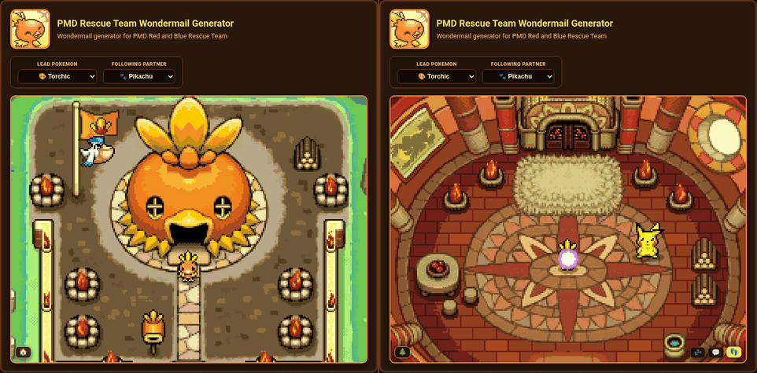
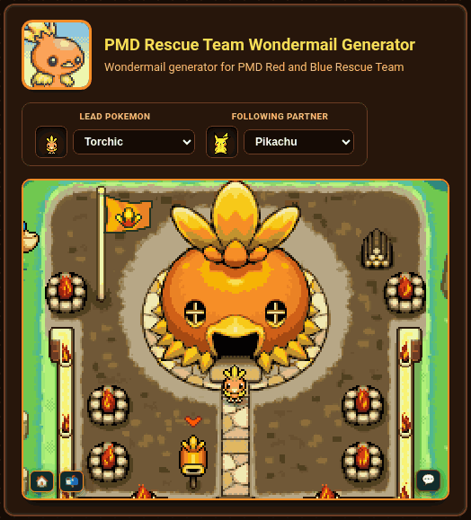
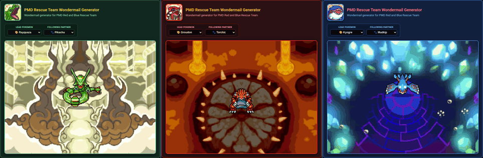
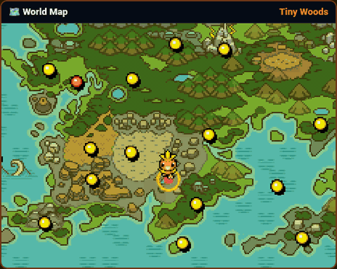
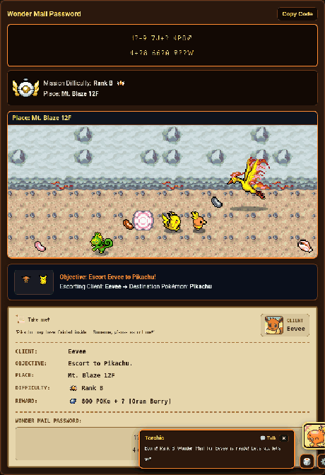

# 📮 PMD Rescue Team Wonder Mail & SOS Mail Generator (`v1.0`)

**A standalone, offline-ready Wonder Mail & SOS Mail generator for _Pokémon Mystery Dungeon: Red Rescue Team_ (GBA) & _Blue Rescue Team_ (Nintendo DS)**

 

*Your Rescue Team Base outside (with a waving team flag, fire braziers, and Pelipper dropping off Wonder Mail letters you can click) and inside (where you can chat with your Partner or take a nap on the cushion bed).*

 

[🌐 **Launch Live Web App (GitHub Pages)**](https://helloyellow-hub.github.io/PMD-Rescue-Team-Wondermail-Generator/) · [📦 **GitHub Releases (`v1.0.0`)**](https://github.com/helloyellow-hub/PMD-Rescue-Team-Wondermail-Generator/releases/latest) · [📥 **Direct Offline HTML (`PMD-Rescue-Team-Mail-Generator-v1.0.html`)**](PMD-Rescue-Team-Mail-Generator-v1.0.html) · [📖 **How to Use**](#-how-to-use-all-4-tabs) · [🏆 **Credits**](#-credits--acknowledgments)

---

## ✨ About This Project

If you still replay *Pokémon Mystery Dungeon: Red Rescue Team* or *Blue Rescue Team*, you probably know the pain of hunting down old Wonder Mail tools that have gone offline, or wiping on floor 75 of *Purity Forest* and *Wish Cave* with nobody around to rescue you.

I put this tool together so everything you need for PMD1 passwords lives in one place and works completely offline. You can run it right in your browser or download `PMD-Rescue-Team-Mail-Generator-v1.0.html` as a single file that holds all the sprites, portraits, maps, fonts, and password logic inside it. Whether you want to roll a job for a Friend Bow or Golden Seed, unlock the four Wonder Mail-only Friend Areas, check what an old code does, or convert your own SOS Mail into an A-OK Mail to revive yourself without a link cable, it handles all of it. Along the way, I also built in an interactive Rescue Team Base, Partner dialogue, a world map tracker, and a little dungeon scene that reacts to the jobs you create.

---

## 🚀 Quick Start

### 1. Play in Your Browser (GitHub Pages)
👉 **[https://helloyellow-hub.github.io/PMD-Rescue-Team-Wondermail-Generator/](https://helloyellow-hub.github.io/PMD-Rescue-Team-Wondermail-Generator/)**

### 2. Use It Offline (Single HTML File)
1. Download [`PMD-Rescue-Team-Mail-Generator-v1.0.html`](PMD-Rescue-Team-Mail-Generator-v1.0.html) (also available on [GitHub Releases](https://github.com/helloyellow-hub/PMD-Rescue-Team-Wondermail-Generator/releases/latest)).
2. Open the file in any desktop or mobile browser (Chrome, Firefox, Safari, or Edge).
3. That's it - no internet connection, local server, or setup needed. Everything is packed into that single HTML file.

---

## 🌟 What's Inside

### 1. 📜 24-Character Wonder Mail Generator & Decoder
Create and inspect 24-character Pelipper Post Office Wonder Mail passwords (`XXXX XXXX XXXX` / `XXXX XXXX XXXX`) that work on both *Red Rescue Team* (GBA) and *Blue Rescue Team* (DS):
- **All 5 Mission Types**:
  - `Help me` - Rescue the client on the target floor.
  - `Find someone` - Track down and rescue a target Pokémon for the client.
  - `Escort to X` - Escort the client through the dungeon to the target Pokémon.
  - `Find item` - Find a specific item inside the dungeon (or bring one in from your Toolbox).
  - `Deliver item` - Bring an item from your Toolbox and hand it to the client on the target floor.
- **Full Gen I-III Pokédex (`#001` Bulbasaur to `#386` Deoxys)**:
  - Search boxes above each dropdown let you quickly filter Clients, Targets, Dungeons, and Rewards with sprite previews. The generator automatically prevents invalid pairings that the game rejects, like setting the same Pokémon as both Client and Target on rescue or escort jobs.
- **Accurate Floors & Item Checks**:
  - Choosing a dungeon fills in its exact `B#F` or `#F` floor count and checks whether a requested item naturally spawns there on *Find item* missions.
- **Rewards & Wonder Mail-Only Friend Areas**:
  - Pick from `Money`, `Money + ? (Item)`, `Item`, `Item + ?`, or `Friend Area`. You can unlock the four Wonder Mail-exclusive Friend Areas (**Mt. Moonview**, **Sky Blue Plains**, **Dragon Cave**, and **Bountiful Sea**), and the tool automatically makes sure the job meets the game's requirement of at least **D-Rank** difficulty (or **Pelipper Isle**).
- **Pelipper Post Office Letter Preview**:
  - Shows a parchment job letter with the client's portrait, PMD1 headline and flavor text, dungeon and floor, Rescue Team Rank badge, difficulty points, reward icon, and your copyable 24-character code (`♂`, `♀`, `…`).
- **Wonder Mail Decoder**:
  - Paste any 24-character Wonder Mail password (supports Unicode `♂` / `♀` / `…` as well as shorthand like `(m)` / `(f)` / `...` or `M` / `F` / `.`) to check if it's valid and see the full mission breakdown on the map, dungeon preview, and job letter.

---

### 2. 🆘 54-Character SOS Mail, A-OK Mail & Thank-You Mail Tools
Full support for 3-line, 54-character rescue passwords (`XXXXX XXXXXXXX XXXXX`):
- **SOS ➔ A-OK Mail Converter (Self-Rescue)**:
  - Wiped deep in *Silver Trench*, *Buried Relic*, *Wish Cave*, or *Purity Forest*? Paste your 54-character **SOS Mail** password to turn it into a matching **A-OK Mail** rescue password right away, and optionally add a bonus reward item to generate a **Thank-You Mail** code too.
  - Works across GBA, Nintendo DS, Virtual Console, and emulators - no GBA Link Cable or DS Wireless connection needed.
- **54-Character Password Decoder**:
  - Paste any SOS, A-OK, or Thank-You Mail code to check the Mail Type, dungeon and floor, fainted Pokémon species and nickname, 4-digit Mail ID, remaining rescue chances, and rescuer name.
- **Custom SOS / A-OK / Thank-You Mail Generator**:
  - Build a 54-character SOS, A-OK, or Thank-You Mail password from scratch for any Pokémon, dungeon, floor, nickname, Mail ID (`0000`-`9999`), rescue chances (`1`-`99`), and reward item, or send it straight over to the converter in one click.

---

### 3. 🎨 19 Starter, Partner & Legendary Themes

*Cycling through the 19 themes - each one changes the UI colors, character portrait, Rescue Team Base (or Legendary Friend Area), and your Partner companion.*

Pick your **Lead Pokémon** from 19 themes and pair them with any of the **17 Following Partners** (or set Partner to `None` if you prefer flying solo):

| Category | Themes Included | Visual Details |
| :--- | :--- | :--- |
| **Gen I-III Fire Starters (3)** | **Torchic** (`#255`), **Charmander** (`#004`), **Cyndaquil** (`#155`) | Species-specific Fire Hut with flickering stone fire braziers outside and inside |
| **Gen I-III Water Starters (3)** | **Squirtle** (`#007`), **Totodile** (`#158`), **Mudkip** (`#258`) | Species-specific Water Base Hut with ocean blue UI colors and a matching team flag |
| **Gen I-III Grass Starters (3)** | **Bulbasaur** (`#001`), **Chikorita** (`#152`), **Treecko** (`#252`) | Species-specific Leaf Base Hut with forest green UI colors |
| **PMD1 Personality Test Starters (7)** | **Pikachu** (`#025`), **Meowth** (`#052`), **Psyduck** (`#054`), **Machop** (`#066`), **Cubone** (`#104`), **Eevee** (`#133`), **Skitty** (`#300`) | Each starter's own Rescue Team Base hut, custom team flag, and matching color palette |
| **Classic Theme (1)** | **Classic / Riolu** (`#447`) | Dark-slate UI with the classic Rock Hut Rescue Team Base |
| **Weather Trio Legendaries (3)** | **Rayquaza** (`#384`), **Groudon** (`#383`), **Kyogre** (`#382`) | Swaps the Rescue Team Base for each Legendary's animated Friend Area |

---

### 4. 🏠 Interactive Rescue Team Base (Outdoor & Indoor Views)
At the top of the page is an interactive scene of your Rescue Team Base that changes with your chosen Lead and Partner:
- **Outside Your Base**:
  - **Waving Team Flag & Fire Braziers**: Your starter's flag waves beside the hut, and picking **Torchic**, **Charmander**, or **Cyndaquil** lights up flaming stone braziers around the yard and inside the room.
  - **Passing Sky Flyers & Legendary Cameos**: Flying Pokémon (*Pelipper, Wingull, Murkrow, Swablu, Altaria, Fearow*) drift across the sky, with occasional rare flybys from Legendaries and Mythicals (*Latias, Latios, Articuno, Zapdos, Moltres, Lugia, Ho-Oh, Mew, Celebi, Jirachi,* and even a very rare *Shiny Celebi*).
  - **Pelipper Mail Drops**: Every so often, **Pelipper** flies overhead and drops a **Wonder Mail Letter** in front of your Lead Pokémon. Clicking or tapping the letter rolls a brand-new Wonder Mail mission in a puff of purple smoke and scrolls down to your new job letter.
- **Inside Your Base (`🏠` / `🌲` Toggle)**:
  - Click the **`🏠`** button in the bottom-left corner of the scene to head inside your base with your Partner:
    - **`💤` (Nap on the Bed)**: Your Lead Pokémon hops onto the cushion bed and curls up to sleep with floating `Zzz`s. Clicking `💤` or `🌲` wakes them back up first.
    - **`💬` (Talk to Partner)**: Your Lead walks over to your Partner, both turn to face each other with PMD1 emotes (`!`, `?`, sweat drop, shock, or sparkles), and your Partner shares a line of dialogue that fits their personality.
    - **`👣` (Stand in the Room)**: Brings your Lead Pokémon back to the emblem in the middle of the room.

---

### 5. 🌋 Animated Legendary Friend Areas (Weather Trio)

*The three Weather Trio themes: Rayquaza at Stratos Lookout, Groudon at Volcanic Pit, and Kyogre at Seafloor Cave.*

If you pick one of the **Weather Trio Legendaries** as your Lead, the Rescue Team Base switches to their Friend Area from *Red & Blue Rescue Team*:
- **Rayquaza (`#384`) - *Stratos Lookout***: Rayquaza rests on the Sky Shrine altar above drifting clouds with an emerald-and-gold color theme.
- **Groudon (`#383`) - *Volcanic Pit***: Glows with pulsing magma runes around Groudon, twin lava waterfalls pouring down the cliffs, and bubbling lava pools.
- **Kyogre (`#382`) - *Seafloor Cave***: Features a glowing ancient sigil on the seafloor beneath Kyogre and streams of bubbles rising through the cavern.

---

### 6. 🗺️ Interactive PMD1 World Map

*The World Map panning across the Red & Blue Rescue Team overworld and pinning the selected dungeon.*

Right above the job letter, the **PMD1 World Map** updates whenever you change dungeons or decode a password, smoothly panning across the *Red & Blue Rescue Team* overworld map and flying a marker to the dungeon you picked.

---

### 7. ⚔️ 3-Lane Dungeon Walker

*The animated dungeon scene updating alongside the password box, Rank bar, and parchment mission letter.*

Next to the map, the **3-Lane Dungeon Walker** brings each mission to life as you build or decode a job:
- **Matching Dungeon Biomes**: Draws the floor tiles and walls for the chosen dungeon's biome (volcanic rock in *Mt. Blaze*, crystal tiles in *Meteor Cave*, grassy paths in *Tiny Woods*, and so on), along with stairs and floor items.
- **Your Rescue Team**: Your Lead Pokémon, Following Partner, and (on *Escort* jobs) the client Pokémon walk through the middle lane together.
- **Wild Pokémon, Dungeon Bosses & Kecleon**:
  - Wild Pokémon that actually live in that dungeon wander across the top and bottom lanes.
  - **25 Story & Legendary Dungeon Bosses**: Picking a boss dungeon brings out its boss in the outer lanes—**Skarmory**, **Gengar**, **Ekans**, **Medicham**, **Mankey**, **Zapdos**, **Moltres**, **Articuno**, **Lugia**, **Ho-Oh**, **Mewtwo**, **Mew**, **Jirachi**, **Regirock**, **Regice**, **Registeel**, **Entei**, **Raikou**, **Suicune**, **Latios**, **Latias**, and all four **Deoxys** forms (*Normal*, *Attack*, *Defense*, and *Speed*) in **Meteor Cave**.
  - **Green & Purple Kecleon**: In dungeons where Kecleon Shops can appear, you might occasionally spot a Green or Purple Kecleon strolling by.
- **Quick Mission Summary**: Shows animated client and target sprites along the bottom bar with a quick readout of the `Place`, `Objective`, `Client`, `Reward`, and `Difficulty`.

---

### 8. 💬 Floating Partner Companion & Randomizer (`🎲`)
- **Partner Chat Bubble**: Click your Partner's portrait (or the `💬 Talk` button) in the bottom-right corner to hear them react as you roll missions, decode passwords, or swap dungeons and items.
- **Portrait & Bubble Settings (`⚙️`)**: Switch your Partner's expression between *Neutral, Happy, Inspired, Determined,* and *Worried* portraits, or toggle auto-close and auto-reset timers.
- **One-Click Randomizer (`🎲`)**: Click the **`🎲`** button in the Partner dock (or next to *Generate Wonder Mail*) to roll a random, game-valid Wonder Mail job and update the map, dungeon preview, and letter all at once.

---

## 📖 How to Use (All 4 Tabs)

### Tab 1: `Wonder Mail Generator` (24-Character Passwords)
1. **Pick a Mission Type** (`Help me`, `Find someone`, `Escort to X`, `Find item`, or `Deliver item`), or click **`🎲`** to roll a random valid job.
2. **Choose Client & Target Pokémon**:
   - Use the search boxes above each dropdown to filter through all 386 Gen I-III Pokémon.
3. **Choose Dungeon, Floor & Letter Text**:
   - Pick your **Dungeon** and **Floor** (if you choose a *Friend Area* reward, the tool automatically makes sure the job is at least **Rank D** or set at *Pelipper Isle*).
   - Write your own **Headline** and **Letter Body** if you want, or leave the default in-game text.
4. **Pick a Reward**:
   - Choose `Money`, `Money + ? (Item)`, `Item`, `Item + ?`, or `Friend Area`, then pick any item (`Friend Bow`, `Golden Seed`, `Tight Belt`, `Gold Ribbon`, `TM`s, etc.) or Wonder Mail-only Friend Area.
5. **Click `Generate Wonder Mail`**:
   - Enter the 2-line, 24-character password (`XXXX XXXX XXXX` / `XXXX XXXX XXXX`) in *Red* or *Blue Rescue Team* under **Main Menu ➔ Wonder Mail ➔ Receive Wonder Mail ➔ Password**.

### Tab 2: `Wonder Mail Decoder` (24-Character Inspector)
1. Paste any **24-character Wonder Mail password** into the box (you can use the **`♂`**, **`♀`**, and **`…`** buttons, or type `(m)`, `(f)`, `...`).
2. Click **`Decode Wonder Mail`** to verify the checksum and see the mission type, client, target, dungeon, floor, rank, reward, and letter text right on the map and parchment preview.

### Tab 3: `SOS ➔ A-OK Converter` (54-Character Self/Friend Rescue)
1. After fainting in a dungeon and choosing to wait for rescue, copy the **54-character (3-line) SOS Mail password** from the Pelipper Post Office menu.
2. Paste that code into the **SOS ➔ A-OK Converter** tab.
3. Optionally fill in a **Rescuer / Team Name** and pick a **Bonus Reward Item** if you also want a **Thank-You Mail** password.
4. Click **`Convert to A-OK Mail`** to get your **54-character A-OK Mail password**, then enter it in-game under **Receive A-OK Mail** to revive right on the floor where you fainted.

### Tab 4: `SOS Mail Generator` (54-Character Custom Generator)
1. Pick a **Mail Mode** (`SOS Mail`, `A-OK Mail`, or `Thank-You Mail`).
2. Choose the **Dungeon**, **Floor**, **Fainted Client Pokémon**, **Nickname**, **4-Digit Mail ID** (`0000`-`9999`), **Remaining Rescue Chances** (`1`-`99`), and optional **Reward Item**.
3. Click **`Generate SOS Mail`** to get the 3-line, 54-character code (`XXXXX XXXXXXXX XXXXX`), or send it straight to the **SOS ➔ A-OK Converter** with one click.

---

## ⚠️ In-Game Rules to Keep in Mind (*Red & Blue Rescue Team*)

*Red* and *Blue Rescue Team* check a few conditions on your save file before letting you accept a password:
1. **Dungeon Must Be Unlocked**: Your save file needs to have unlocked that dungeon already before the game will let you take a job there.
2. **Friend Area Rules**:
   - For **Escort** jobs (or jobs where a client wants to join your team), you need to already own the relevant Friend Area in-game.
   - For the four **Wonder Mail-Exclusive Friend Areas** (*Mt. Moonview*, *Sky Blue Plains*, *Dragon Cave*, and *Bountiful Sea*), you must *not* already own that Friend Area, and the job has to be at least **Rank D** difficulty (or at **Pelipper Isle**) - the generator handles this difficulty rule for you automatically.
3. **Special Symbols (`♂`, `♀`, `…`)**:
   - In passwords, `♂` is the Male sign, `♀` is the Female sign, and `…` is the single-character ellipsis on the in-game password keyboard (not three separate periods).

---

## 🏆 Credits & Acknowledgments

### 🛠️ Project Creator
- **Put Together by:** **Dave Alfred** [[GitHub]](https://github.com/helloyellow-hub)

### 🔐 Password & Checksum Research
- **[UPokeCenter (Peter O. / The Ultimate Pokémon Center)](https://www.upokecenter.com/games/dungeon/guides/wondermail.php)** - Huge thanks to UPokeCenter (`wondermail.php` and `sosgen.php`) for documenting and reverse-engineering the original *Pokémon Mystery Dungeon: Red & Blue Rescue Team* 24-character Wonder Mail and 54-character SOS / A-OK / Thank-You Mail bit-packing tables, checksums, encryption tables, mission validation rules, and flavor text.

### 🎨 Sprites, Portraits & Maps
- **[The Spriters Resource](https://www.spriters-resource.com/game_boy_advance/pokemonmysterydungeonredrescueteam/)** - *Red/Blue Rescue Team* and *Explorers* Rescue Team Base huts (inside and out), waving flags, fire braziers, Friend Area backgrounds (*Volcanic Pit*, *Seafloor Cave*), Pelipper mail-carrier sprites, and PMD1 emotion icons (ripped by KillerAslox).
- **[PMD Collab / SpriteCollab](https://sprites.pmdcollab.org/)** - CHUNSOFT character portraits and directional idle, walking, and sleeping sprites for all 386 Gen I-III Pokémon.
- **[Bulbapedia & Bulbagarden Archives](https://bulbapedia.bulbagarden.net/wiki/Pok%C3%A9mon_Mystery_Dungeon:_Red_Rescue_Team_and_Blue_Rescue_Team)** - Dungeon floor tables, item icons, Rescue Team rank badges, boss lists, and overworld map references.

### 🎮 Original Games
- ***Pokémon Mystery Dungeon: Red Rescue Team* & *Blue Rescue Team*** - Developed by **Chunsoft (Spike Chunsoft)** and published by **Nintendo** & **The Pokémon Company** (© 2005-2006 Nintendo / Creatures Inc. / GAME FREAK inc. / Chunsoft).
- *Disclaimer*: This is an unofficial, non-commercial fan project made for community use and game preservation. All Pokémon names, characters, sprites, and trademarks belong to Nintendo, Creatures Inc., GAME FREAK inc., The Pokémon Company, and Spike Chunsoft.
